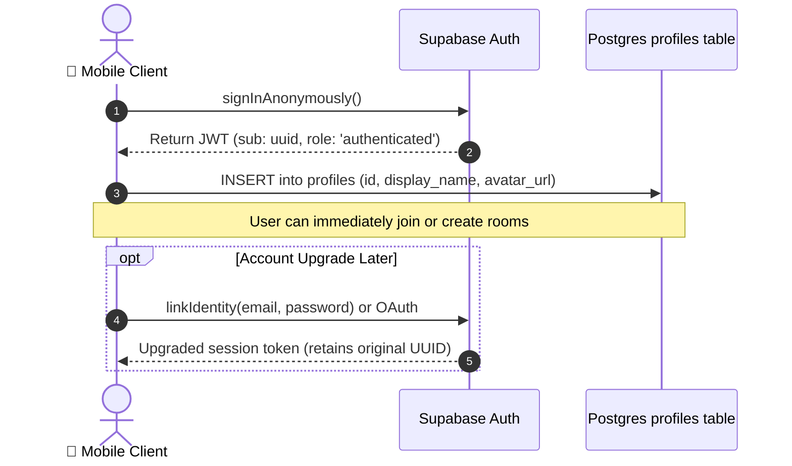

# TabTogether - API & Real-Time Protocol Specification (API_REALTIME.md)

> **Assumptions**:
> 1. Mobile app connects to Supabase via `@supabase/supabase-js` v2 over HTTPS and Secure WebSockets (`wss://`).
> 2. Ephemeral interactions (slider drags, cursor presence) run on Supabase Realtime Broadcast Channels.
> 3. State persistence (creating items, committing claims, recording payment) runs through PostgreSQL RPC functions.

---

## 1. Authentication & Session Protocol

### Anonymous Guest to Verified User:


---

## 2. Room Join via QR & PIN Protocol

### Deep Link Schema:
```text
tabtogether://room/join?slug=DINE-8821&pin=4821
```
Or web fallback:
```text
https://tabtogether.app/r/DINE-8821?pin=4821
```

### Security & Rate Limiting for 4-Digit PINs:
- **PIN Expiration**: A room's PIN expires automatically after **24 hours** from room creation.
- **Brute-Force Guard**: Maximum **5 failed attempts per client IP / device identifier per 5 minutes**. On the 6th failure, the client is throttled with an HTTP `429 Too Many Requests` status and locked out for 15 minutes.
- **PIN Storage**: Stored as a salted hash in PostgreSQL using `pgcrypto.crypt(pin, pgcrypto.gen_salt('bf'))`.

---

## 3. Remote Procedure Calls (RPC Endpoints)

### `create_room`
- **Caller**: Host client
- **Arguments**:
  ```json
  {
    "title": "Friday Night Dinner",
    "pin": "4821",
    "tax_rate_bps": 8875,
    "tip_rate_bps": 1800,
    "currency": "USD"
  }
  ```
- **Returns**: `{ "room_id": "uuid", "qr_slug": "DINE-8821", "role": "host" }`

---

### `join_room_by_pin`
- **Caller**: Guest client entering PIN or scanning QR
- **Arguments**:
  ```json
  {
    "qr_slug": "DINE-8821",
    "pin": "4821"
  }
  ```
- **Validation**:
  1. Lookup room by `qr_slug` where `status = 'active'`.
  2. Verify PIN hash matches `pin`.
  3. Insert into `room_members (room_id, user_id, role)` if not already joined.
  4. Emit activity event `MEMBER_JOINED`.
- **Returns**: Full room bootstrap bundle:
  ```json
  {
    "room": { "id": "uuid", "title": "...", "status": "active", ... },
    "members": [ ... ],
    "items": [ ... ],
    "shares": [ ... ],
    "my_role": "guest"
  }
  ```

---

### `adjust_item_shares`
- **Caller**: Any room member committing an adjusted slider share
- **Arguments**:
  ```json
  {
    "item_id": "uuid",
    "expected_version": 4,
    "shares": [
      { "member_id": "uuid_1", "basis_points": 5000, "is_locked": false },
      { "member_id": "uuid_2", "basis_points": 5000, "is_locked": false }
    ]
  }
  ```
- **Invariants Checked in SQL Transaction**:
  - `sum(basis_points) == 10000` (or 0 if unclaimed).
  - Version check prevents race conditions.
  - Recalculates `allocated_cents` using the Largest Remainder Method.
- **Returns**: `{ "success": true, "new_version": 5, "updated_shares": [ ... ] }`

---

### `record_payment`
- **Caller**: Participant marking their share paid
- **Arguments**:
  ```json
  {
    "room_id": "uuid",
    "payment_method": "venmo",
    "tx_reference": "VENMO-TX-998"
  }
  ```
- **Action**:
  - Sets member `payment_status = 'paid'`, `paid_at = now()`.
  - Records row in `payments`.
  - Emits real-time event.

---

## 4. Supabase Real-Time Channels & Event Payloads

### Channel: `room:{room_id}`

#### 1. Presence (Who is online & active)
Tracks participants currently viewing the room.
```json
{
  "presence_ref": "ref_123",
  "user_id": "uuid_alice",
  "display_name": "Alice",
  "avatar_url": "...",
  "current_screen": "claim_modal",
  "active_item_id": "uuid_pizza_item"
}
```

#### 2. Broadcast Events (Ephemeral & Low Latency)

##### Event: `SLIDER_DRAGGING`
Emitted at 60fps during slider manipulation to give visual presence without DB load.
```json
{
  "event": "SLIDER_DRAGGING",
  "payload": {
    "item_id": "uuid_nachos",
    "user_id": "uuid_bob",
    "temp_bps": 3333
  }
}
```

##### Event: `USER_TYPING_ITEM`
Emitted when someone starts creating an item.
```json
{
  "event": "USER_TYPING_ITEM",
  "payload": {
    "user_id": "uuid_sam",
    "message": "Sam is adding an item..."
  }
}
```

#### 3. Database CDC Events (`postgres_changes`)

| Postgres Table | Operation | Client Reaction |
| :--- | :--- | :--- |
| `items` | `INSERT` | Appends item card into Item Feed; plays sound; animates into list. |
| `items` | `UPDATE` | Updates price/quantity; recalculates room total hero card. |
| `item_shares` | `UPDATE` | Re-renders member share badges and settlement preview. |
| `room_members` | `UPDATE` | Updates payment indicator badge (Amber $\rightarrow$ Emerald). |
| `activity_events` | `INSERT` | Prepend event to Activity stream with animated entry. |
