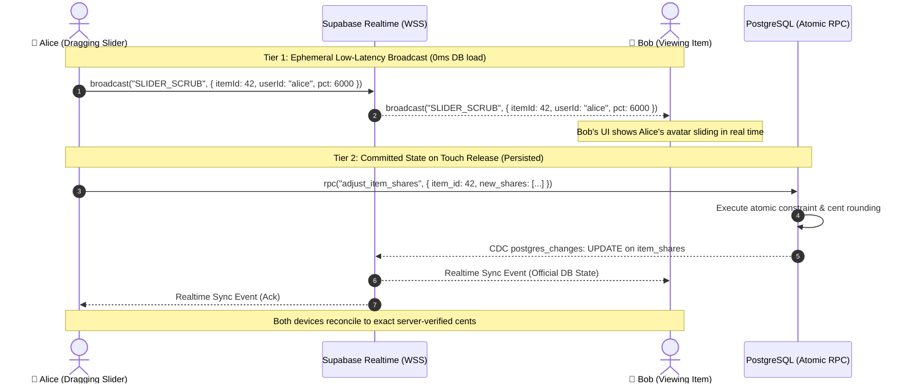
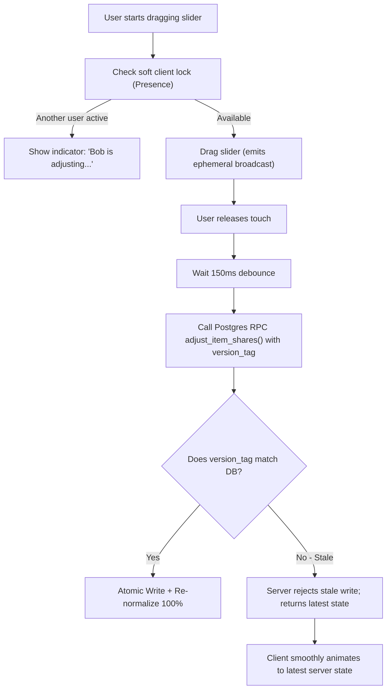
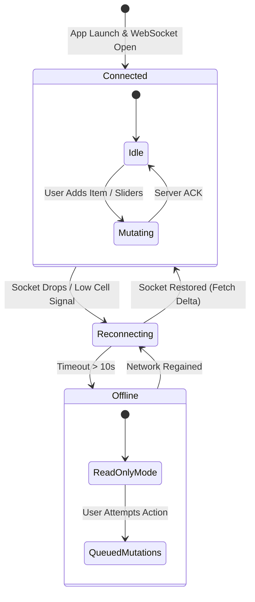

# TabTogether - Architecture & Real-Time Sync Specification (ARCHITECTURE.md)

> **Assumptions**:
> 1. Clients communicate with the backend via HTTPS (REST/RPC) and Secure WebSockets (WSS).
> 2. Ephemeral interactions (e.g. slider scrubbing) use WebSocket Broadcast; final values commit to PostgreSQL.
> 3. Server-side validation via PostgreSQL functions is the single source of truth for all mathematical invariants.

---

## 1. System Architecture Diagram

```mermaid
flowchart TD
    subgraph Mobile_Clients [Mobile Clients (React Native / Expo)]
        ClientA["📱 Client A (Host)"]
        ClientB["📱 Client B (Guest 1)"]
        ClientC["📱 Client C (Guest 2)"]
    end

    subgraph Edge_Gateway [Supabase Realtime & Edge Gateway]
        WS_Broker["Supabase Realtime (WebSockets)
        • Broadcast (Slider Scrubbing)
        • Presence (Who is Online)
        • Postgres CDC Events"]
        API_GW["REST / RPC Endpoint (HTTPS)
        • Session & PIN Auth
        • Atomic Split Calculations"]
    end

    subgraph Data_Layer [PostgreSQL Database & Logic]
        RLS["Row Level Security (RLS)
        Room-Member Validation"]
        Tables[("Postgres Tables
        • rooms
        • room_members
        • items
        • item_shares
        • payments")]
        StoredProc["Atomic RPC Functions
        • adjust_item_shares()
        • settle_room()
        • join_room_by_pin()"]
    end

    ClientA <-->|WSS (Realtime)| WS_Broker
    ClientB <-->|WSS (Realtime)| WS_Broker
    ClientC <-->|WSS (Realtime)| WS_Broker

    ClientA -->|HTTPS Mutations| API_GW
    ClientB -->|HTTPS Mutations| API_GW
    ClientC -->|HTTPS Mutations| API_GW

    API_GW --> RLS --> StoredProc --> Tables
    Tables -.->|CDC Trigger| WS_Broker
```

---

## 2. Real-Time Synchronization Strategy

TabTogether uses a **Two-Tier Real-Time Architecture**:



### 1. Ephemeral Tier (Broadcast & Presence):
- **Purpose**: Interactive slider scrubbing at 60fps and typing indicators.
- **Latency**: $20 - 50\text{ms}$.
- **Cost / Overhead**: Zero database writes.
- **Payload**: `{ event: "SLIDER_SCRUB", item_id: string, user_id: string, temp_percentage: number }`.

### 2. Persistence Tier (Postgres CDC + RPC):
- **Purpose**: Permanent state changes (item created, slider released, payment confirmed).
- **Commit Trigger**: Debounced by 150ms after the user lifts their finger from the slider.
- **Latency**: $100 - 250\text{ms}$.

---

## 3. Conflict Resolution Engine

### Problem Statement:
What happens if Alice and Bob are both in the "Claim & Adjust" modal for a $30 Pizza and drag their sliders simultaneously?



### Conflict Mitigation Rules:
1. **Optimistic Locking via `version_tag`**: Each `item` record has an integer `version` field. When submitting a share adjustment, the client passes the current `version`. If another user committed a change 50ms prior, the version will have incremented, and the server safely rejects the outdated transaction.
2. **Deterministic Proportional Redistribution**:
   - If User A increases their share by $X\%$, the surplus is subtracted proportionally from all **unlocked** participants.
   - If all other participants are locked, the slider cannot be dragged further without unlocking someone else.
3. **Single Source of Truth**: The client never calculates the final dollar cent split locally for persistence. The PostgreSQL RPC function executes integer cent math (see `SPLIT_LOGIC.md`) and returns the authoritatively rounded rows to all subscribers.

---

## 4. Network State Machine & Offline Handling



- **Online (Green)**: Full live real-time bidirectional sync.
- **Reconnecting (Amber)**: The app displays an amber top pill *"Reconnecting to room..."*. Reads are served from local Zustand/TanStack cache. Slider dragging is disabled to prevent conflicting out-of-sync writes.
- **Offline (Red)**: The app enters a safe Read-Only mode. Users are prompted with a friendly banner: *"You are offline. Please reconnect to cellular or Wi-Fi to adjust claims or settle."*
- **Re-synchronization upon Reconnect**: Upon reconnecting, the client calls `get_room_bundle(room_id)` to rehydrate the complete room state, replacing any stale local state.
