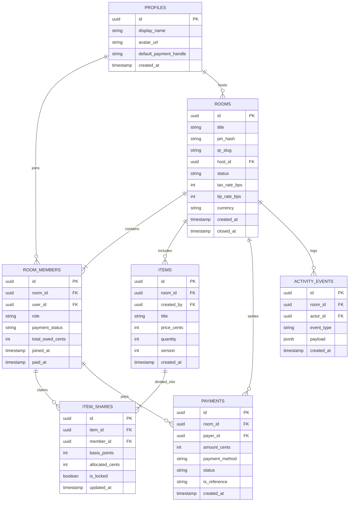

# TabTogether - Relational Data Model Specification (DATA_MODEL.md)

> **Assumptions**:
> 1. All financial values are stored as integers representing **cents** (e.g. `$210.00` is stored as `21000`).
> 2. All percentage values are stored as integer **basis points** ($1\% = 100\text{ bps}$, $100\% = 10000\text{ bps}$).
> 3. Database is PostgreSQL 15+ hosted on Supabase.

---

## 1. Entity-Relationship (ER) Diagram



---

## 2. PostgreSQL DDL Schema Definitions

### 1. `profiles`
Stores user profile information (both registered users and guest sessions).
```sql
CREATE TABLE public.profiles (
    id UUID PRIMARY KEY REFERENCES auth.users(id) ON DELETE CASCADE,
    display_name TEXT NOT NULL CHECK (char_length(display_name) >= 2),
    avatar_url TEXT NOT NULL DEFAULT 'https://api.dicebear.com/7.x/bottts/svg?seed=guest',
    payment_handle TEXT, -- e.g. "venmo:@alex_split" or "revolut:@alex12"
    created_at TIMESTAMPTZ NOT NULL DEFAULT timezone('utc', now())
);
```

### 2. `rooms`
Stores bill rooms created by hosts.
```sql
CREATE TYPE room_status AS ENUM ('active', 'settling', 'settled', 'archived');

CREATE TABLE public.rooms (
    id UUID PRIMARY KEY DEFAULT gen_random_uuid(),
    title TEXT NOT NULL DEFAULT 'Dinner Bill',
    host_id UUID NOT NULL REFERENCES public.profiles(id) ON DELETE CASCADE,
    pin_hash TEXT NOT NULL,           -- Argon2 / bcrypt hash of 4-digit PIN
    qr_slug TEXT UNIQUE NOT NULL,     -- Short code for QR URL
    status room_status NOT NULL DEFAULT 'active',
    tax_rate_bps INT NOT NULL DEFAULT 0 CHECK (tax_rate_bps >= 0),    -- e.g. 8875 = 8.875%
    tip_rate_bps INT NOT NULL DEFAULT 1800 CHECK (tip_rate_bps >= 0), -- e.g. 1800 = 18.00%
    currency VARCHAR(3) NOT NULL DEFAULT 'USD',
    created_at TIMESTAMPTZ NOT NULL DEFAULT timezone('utc', now()),
    closed_at TIMESTAMPTZ
);

CREATE INDEX idx_rooms_qr_slug ON public.rooms(qr_slug);
```

### 3. `room_members`
Junction table linking users to rooms with their payment and settlement status.
```sql
CREATE TYPE member_role AS ENUM ('host', 'guest');
CREATE TYPE payment_status AS ENUM ('pending', 'paid', 'verified');

CREATE TABLE public.room_members (
    id UUID PRIMARY KEY DEFAULT gen_random_uuid(),
    room_id UUID NOT NULL REFERENCES public.rooms(id) ON DELETE CASCADE,
    user_id UUID NOT NULL REFERENCES public.profiles(id) ON DELETE CASCADE,
    role member_role NOT NULL DEFAULT 'guest',
    payment_status payment_status NOT NULL DEFAULT 'pending',
    total_owed_cents INT NOT NULL DEFAULT 0 CHECK (total_owed_cents >= 0),
    joined_at TIMESTAMPTZ NOT NULL DEFAULT timezone('utc', now()),
    paid_at TIMESTAMPTZ,
    UNIQUE(room_id, user_id)
);

CREATE INDEX idx_room_members_room ON public.room_members(room_id);
```

### 4. `items`
Individual bill line items.
```sql
CREATE TABLE public.items (
    id UUID PRIMARY KEY DEFAULT gen_random_uuid(),
    room_id UUID NOT NULL REFERENCES public.rooms(id) ON DELETE CASCADE,
    created_by UUID NOT NULL REFERENCES public.profiles(id),
    title TEXT NOT NULL CHECK (char_length(title) >= 1),
    price_cents INT NOT NULL CHECK (price_cents > 0),
    quantity INT NOT NULL DEFAULT 1 CHECK (quantity > 0),
    version INT NOT NULL DEFAULT 1, -- Optimistic locking counter
    created_at TIMESTAMPTZ NOT NULL DEFAULT timezone('utc', now())
);

CREATE INDEX idx_items_room ON public.items(room_id);
```

### 5. `item_shares`
Allocations of items among room members.
```sql
CREATE TABLE public.item_shares (
    id UUID PRIMARY KEY DEFAULT gen_random_uuid(),
    item_id UUID NOT NULL REFERENCES public.items(id) ON DELETE CASCADE,
    member_id UUID NOT NULL REFERENCES public.room_members(id) ON DELETE CASCADE,
    basis_points INT NOT NULL CHECK (basis_points >= 0 AND basis_points <= 10000),
    allocated_cents INT NOT NULL DEFAULT 0 CHECK (allocated_cents >= 0),
    is_locked BOOLEAN NOT NULL DEFAULT FALSE,
    updated_at TIMESTAMPTZ NOT NULL DEFAULT timezone('utc', now()),
    UNIQUE(item_id, member_id)
);

CREATE INDEX idx_item_shares_item ON public.item_shares(item_id);
CREATE INDEX idx_item_shares_member ON public.item_shares(member_id);
```

### 6. `payments`
Tracks settlement transactions.
```sql
CREATE TYPE payment_record_status AS ENUM ('submitted', 'confirmed', 'rejected');

CREATE TABLE public.payments (
    id UUID PRIMARY KEY DEFAULT gen_random_uuid(),
    room_id UUID NOT NULL REFERENCES public.rooms(id) ON DELETE CASCADE,
    payer_id UUID NOT NULL REFERENCES public.room_members(id) ON DELETE CASCADE,
    amount_cents INT NOT NULL CHECK (amount_cents > 0),
    payment_method TEXT NOT NULL DEFAULT 'venmo', -- 'venmo', 'cashapp', 'cash', 'card'
    status payment_record_status NOT NULL DEFAULT 'submitted',
    tx_reference TEXT,
    created_at TIMESTAMPTZ NOT NULL DEFAULT timezone('utc', now())
);

CREATE INDEX idx_payments_room ON public.payments(room_id);
```

### 7. `activity_events`
Audit log and real-time feed stream.
```sql
CREATE TABLE public.activity_events (
    id UUID PRIMARY KEY DEFAULT gen_random_uuid(),
    room_id UUID NOT NULL REFERENCES public.rooms(id) ON DELETE CASCADE,
    actor_id UUID REFERENCES public.profiles(id) ON DELETE SET NULL,
    event_type TEXT NOT NULL,
    payload JSONB NOT NULL DEFAULT '{}'::jsonb,
    created_at TIMESTAMPTZ NOT NULL DEFAULT timezone('utc', now())
);

CREATE INDEX idx_activity_room ON public.activity_events(room_id, created_at DESC);
```

---

## 3. Data Integrity & Mathematical Constraints

1. **Item Shares Invariant**: The total `basis_points` across all `item_shares` for a single `item` must be either $0$ (completely unclaimed) or strictly equal $10000$ ($100.00\%$) when claimed.
2. **Cents Sum Invariant**: $\sum (\text{allocated\_cents}) = \text{price\_cents} \times \text{quantity}$ for any claimed item. No pennies are created or destroyed.
3. **Optimistic Locking**: Every `UPDATE` on `items` or `item_shares` checks `version = :expected_version` and increments `version = version + 1`.
