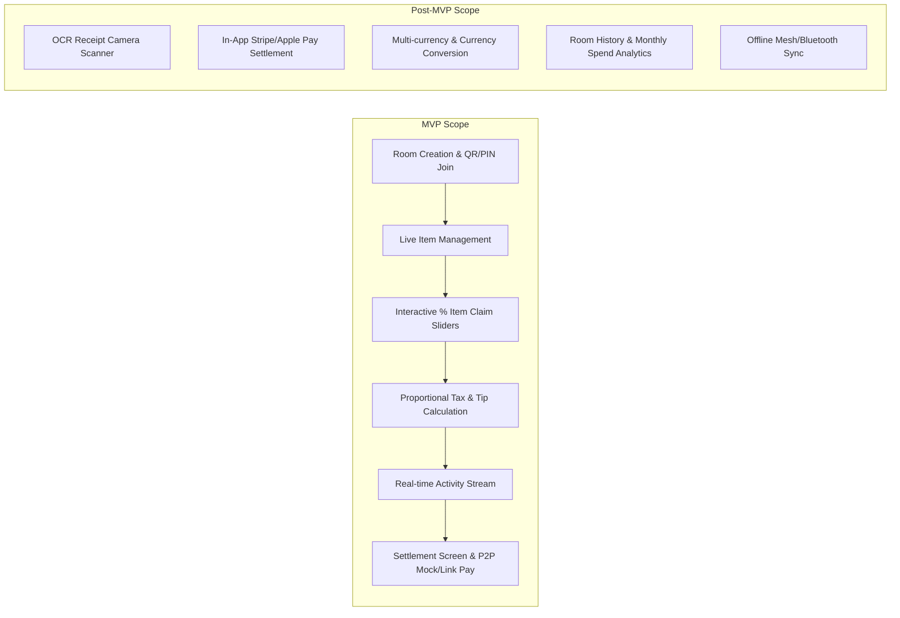

# TabTogether - Product Requirements Document (PRD)

> **Assumptions**: 
> 1. Target launch platform is iOS and Android via a single cross-platform codebase.
> 2. MVP targets social dining and casual group expenses among friends (trust-based network); real banking/escrow payment settlement is out of scope for MVP (using mock or deep-link settlement).
> 3. Users can join as lightweight authenticated users or guests with device persistence.

---

## 1. Product Summary & Vision
**TabTogether** is a mobile-first, real-time collaborative bill splitter designed for live group dining, trips, and shared events. Instead of a single person doing stressful post-dinner calculator gymnastics, all table participants join a shared live room via QR code or 4-digit PIN. Everyone adds what they ordered, claims full items or percentages via intuitive sliders (guaranteed to total 100%), factors in tax and tip proportionally, and settles their individual share in one tap.

---

## 2. Target Users & Personas

| Persona | Role | Key Pain Points | Goal in TabTogether |
| :--- | :--- | :--- | :--- |
| **"The Host" (Alex, 22)** | Organizes dinners & pays the waiter upfront. | Dread chasing friends for money on Venmo for 3 days; calculating unequal appetizers/drinks. | Wants everyone to settle up before leaving the restaurant table. |
| **"The Light Eater" (Sam, 20)** | Ordered a side salad while others ordered steak and cocktails. | Resents equal split ("Split by N"); feels awkward speaking up. | Wants to pay exactly for what they ate plus fair tax/tip. |
| **"The Sharer" (Maya & Leo, 21)** | Shared an entrée or a bottle of wine between 2-3 people. | Splitting individual items across subsets of people is messy in existing apps. | Wants to drag a slider to claim 50% or 33% without breaking the math. |

---

## 3. User Stories

### Epics & Core Stories
- **Room Lifecycle**:
  - *As a Host*, I want to create a room with one tap and display a QR code/PIN so my friends can join in seconds.
  - *As a Guest*, I want to scan a QR code or enter a 4-digit PIN so I don't need to register an elaborate account before ordering.
- **Collaborative Bill Entry**:
  - *As a Participant*, I want to add items with title, quantity, and price so that they appear instantly on everyone's screen.
  - *As a Participant*, I want to see who added or claimed each item via real-time badges and avatars.
- **Item Claiming & % Sliders**:
  - *As a Participant*, I want to claim 100% of an item I had to myself with a single tap.
  - *As a Group*, we want to split a shared item (e.g. Nachos) across 2 or more people using sliders, ensuring the sum always equals 100%.
- **Settlement & Payment**:
  - *As a Participant*, I want to see my live total breakdown (my items + my proportional share of tax and tip).
  - *As a Host*, I want a live settlement dashboard showing who has paid and who is pending.
  - *As a Participant*, I want to tap "Pay Now" to settle via P2P payment links (Venmo/CashApp/Revolut) or mark as cash-paid.

---

## 4. Scope: MVP vs. Post-MVP

### In-Scope (MVP)
- **11 Pre-designed Screens**: Splash, Onboarding (3 slides), Login, Signup, Room Home, Join via QR/PIN, Items Feed, Claim & Adjust (Sliders), Settlement, Activity, Me/Profile.
- **Real-time Sync**: Sub-second synchronization of room items, claims, slider drags, and payment flags.
- **Interactive Split Engine**: 100% invariant enforcement across slider claims, penny-perfect cent distribution, and proportional tax/tip splitting.
- **Payment Settlement**: Instant share calculation with "Mark Paid" verification and P2P deep links (Venmo, Cash App, Revolut, Zelle).

### Non-Goals (MVP)
- **Direct Card Processing / Escrow**: TabTogether will not hold funds or act as a regulated money transmitter in MVP.
- **AI / OCR Receipt Scanning**: Scanning receipts via camera will be prioritized for V2; items are typed manually in MVP to ensure real-time stability first.
- **Multi-Room Accounting**: Splitwise-style running balances across months is out of scope; TabTogether focuses strictly on single-event live sessions.

---

## 5. Unclear / Inconsistent Design Items & Proposed Fixes

| # | Observed Design Tension | Risk / Ambiguity | Proposed Engineering Fix |
| :--- | :--- | :--- | :--- |
| **1** | **Per-person % Sliders with 100% constraint** | If 3 people adjust sliders concurrently on separate phones, their inputs will conflict and sum $\ne 100\%$. | Implement a **Master-Anchor Slider Algorithm**: when Person A moves their slider, the remaining non-locked participants' shares are proportionally scaled down/up. Concurrency uses WebSocket locks or ephemeral drag states before committing to DB. |
| **2** | **4-Digit PIN Security** | 4-digit PINs ($0000-9999$) can be brute-forced within seconds if exposed via an unrestricted public endpoint. | Enforce room-level rate limiting: 5 failed attempts per IP per 5 minutes triggers exponential backoff. In addition, PINs expire 24 hours after room creation. |
| **3** | **Unclaimed Items at Settlement** | What happens if the group tries to settle while $30 of appetizers remain unclaimed? | The Settlement screen displays an amber banner: *"Unclaimed items remain ($30.00)"* and prompts: *"Split unclaimed equally across all"* or *"Assign to Host"*. |
| **4** | **Tax & Tip Allocation** | Does an attendee who ordered a \$10 beer pay the same tip dollar amount as someone who ordered an \$80 steak? | The split engine uses **proportional distribution** by default: your share of tax & tip matches your percentage of the food/drink subtotal. An optional toggle allows "Equal split of tax & tip". |
| **5** | **Offline Intermittent Connectivity in Restaurants** | Basements and restaurants often have poor cellular connectivity. | Store room state locally with optimistic UI updates. When connection drops, show an indicator *"Reconnecting..."* and queue mutations. |
