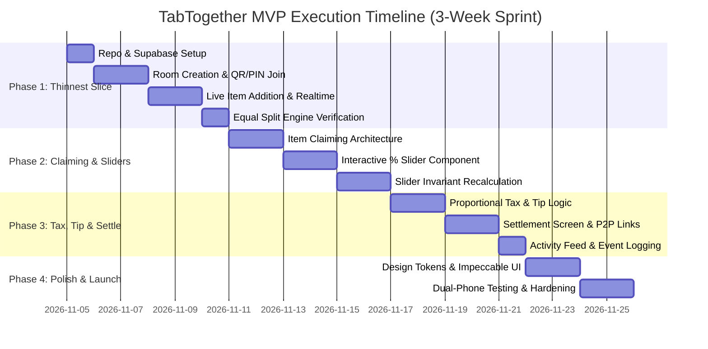

# TabTogether - Phased Development Roadmap (ROADMAP.md)

> **Assumptions**:
> 1. Development executed by a solo student developer dedicating ~15–20 hours/week.
> 2. Strategy: **Thinnest Working Vertical Slice** first (a live room where two phones see the same bill and split equally), then progressive enhancement with sliders, tax/tip, and payments.

---

## 1. Roadmap Overview & Timeline

---

## 2. Phase-by-Phase Task Breakdown & Effort Estimates

### Phase 1: The Thinnest Working Vertical Slice (Days 1–5)
**Goal**: Open two physical phones, scan a QR code, add an item on Phone 1, see it appear immediately on Phone 2, and see an equal split.
- **Task 1.1**: Initialize Expo React Native project with TypeScript and Expo Router. *(4 hours)*
- **Task 1.2**: Provision Supabase project; run SQL migrations for `rooms`, `room_members`, `items`. *(3 hours)*
- **Task 1.3**: Implement Anonymous Guest Auth with nickname and Memoji selection. *(3 hours)*
- **Task 1.4**: Build "Create Room" + QR generator & camera QR scanner. *(4 hours)*
- **Task 1.5**: Build "Add Item" bottom sheet and subscribe to Supabase `postgres_changes`. *(4 hours)*
- **Task 1.6**: Implement basic Equal Split calculation ($N$ people = $\text{Total} / N$). *(2 hours)*
- **Milestone Gate 1**: Two phones join the same room; adding a $20 pizza shows $10/person live on both devices.

---

### Phase 2: Claiming & Interactive Percentage Sliders (Days 6–10)
**Goal**: Allow individual item claiming and proportional percentage sliders that sum to 100%.
- **Task 2.1**: Implement `item_shares` table and PostgreSQL RPC `adjust_item_shares`. *(4 hours)*
- **Task 2.2**: Build the custom `PercentageSlider` component with 48px touch handles and magnetic snapping. *(5 hours)*
- **Task 2.3**: Hook up Supabase Realtime Broadcast for 60fps ephemeral slider scrubbing. *(3 hours)*
- **Task 2.4**: Implement multi-user lock/unlock logic to prevent slider race conditions. *(4 hours)*
- **Task 2.5**: Integrate Largest Remainder Method in TypeScript and PostgreSQL for penny rounding. *(3 hours)*
- **Milestone Gate 2**: Three phones in one room can drag sliders on a shared $30 appetizer; totals strictly maintain $100\%$, and each person's dollar share is exact.

---

### Phase 3: Tax, Tip, Settlement & Payment (Days 11–15)
**Goal**: Complete the dining workflow from food items to settlement and payment confirmation.
- **Task 3.1**: Implement Tax & Tip configuration in Room settings (8.875% tax, 18% tip default). *(3 hours)*
- **Task 3.2**: Build proportional tax/tip apportionment engine (see `SPLIT_LOGIC.md`). *(3 hours)*
- **Task 3.3**: Build Settlement Screen displaying "Your Share to Pay" and "Who Has Paid". *(4 hours)*
- **Task 3.4**: Integrate P2P Deep Links (Venmo, Cash App, Revolut) and "Mark as Paid" action. *(3 hours)*
- **Task 3.5**: Implement Live Activity Feed logging joins, claims, and settlements. *(3 hours)*
- **Milestone Gate 3**: Full end-to-end dinner flow passes: items entered $\rightarrow$ claimed $\rightarrow$ tax/tip added $\rightarrow$ guest pays host via Venmo $\rightarrow$ host confirms.

---

### Phase 4: Polish, Security & Pre-Launch Hardening (Days 16–19)
**Goal**: Deliver a polished, bug-free, tactile mobile experience matching the Figma design.
- **Task 4.1**: Implement Impeccable UI styling: `#F4F7FC` canvas, ticket notch cards, Inter font, pill buttons. *(4 hours)*
- **Task 4.2**: Add `expo-haptics` feedback to button taps, slider snaps, and join confirmations. *(2 hours)*
- **Task 4.3**: Enforce PostgreSQL Row Level Security (RLS) policies and PIN brute-force rate limits. *(3 hours)*
- **Task 4.4**: Build Onboarding (3 slides) and Profile / Me screen. *(3 hours)*
- **Task 4.5**: Offline reconnection handling (network status indicator, cache rehydration). *(3 hours)*
- **Milestone Gate 4**: Production-ready build deployed to Expo EAS Update for internal dogfooding with friends.
