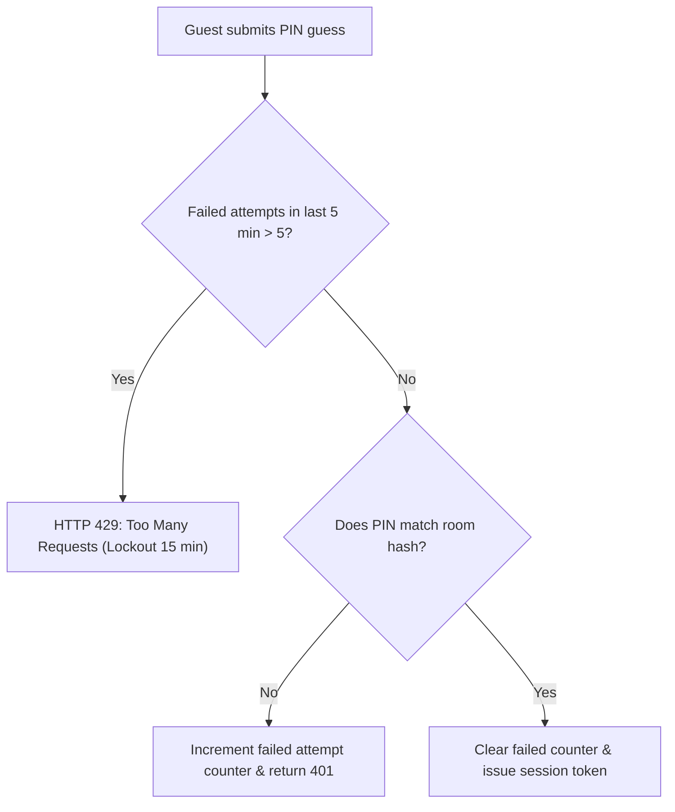

# TabTogether - Security & Privacy Specification (SECURITY.md)

> **Assumptions**:
> 1. In MVP, payments are settled via peer-to-peer external links (Venmo, Cash App, Revolut, Zelle) or in-app mock confirmation. TabTogether does not touch credit cards, bank accounts, or hold escrow funds.
> 2. Access control is enforced at the database level using PostgreSQL Row Level Security (RLS).

---

## 1. Threat Model & Mitigations

| Threat | Risk Level | Description | Mitigation Strategy |
| :--- | :--- | :--- | :--- |
| **PIN Brute-Forcing** | High | An attacker iterates 10,000 combinations (0000–9999) to snoop on active dinner bills. | 1. Rate-limiting: Max 5 attempts / IP / 5 mins.<br>2. 24h room auto-expiry.<br>3. PIN stored as salted hash (`bcrypt`/`argon2`).<br>4. High-entropy UUIDs used for room IDs. |
| **Unauthorized Share Tampering** | Medium | A malicious guest modifies someone else's bill claim to pay less. | RLS policies only allow room members to modify claims. All share updates pass through the atomic Postgres RPC `adjust_item_shares()` which enforces mathematical constraints. |
| **Spoofed Payment Confirmation** | Low (Social context) | A user marks themselves as "Paid" without actually sending money. | The host's settlement screen shows a distinct status: **"Self-Marked as Paid"** vs **"Host-Verified"**. The host has a single-tap "Confirm Receipt" button. |
| **Data Scraping / Eavesdropping** | Low | Non-members reading itemized dinner receipts. | RLS ensures only users present in `room_members` can query `items`, `item_shares`, and `activity_events`. |

---

## 2. PostgreSQL Row Level Security (RLS) Policies

All tables have RLS enabled by default:
```sql
ALTER TABLE public.rooms ENABLE ROW LEVEL SECURITY;
ALTER TABLE public.room_members ENABLE ROW LEVEL SECURITY;
ALTER TABLE public.items ENABLE ROW LEVEL SECURITY;
ALTER TABLE public.item_shares ENABLE ROW LEVEL SECURITY;
ALTER TABLE public.payments ENABLE ROW LEVEL SECURITY;
ALTER TABLE public.activity_events ENABLE ROW LEVEL SECURITY;
```

### Policy 1: Room Read Access
A user can only select a room if they are a confirmed member of that room.
```sql
CREATE POLICY "Members can view their rooms"
ON public.rooms
FOR SELECT
USING (
    auth.uid() = host_id OR
    EXISTS (
        SELECT 1 FROM public.room_members
        WHERE room_members.room_id = rooms.id
        AND room_members.user_id = auth.uid()
    )
);
```

### Policy 2: Item Creation & Modification
Only members of a room can insert or update items within that room, and only while the room status is `'active'`.
```sql
CREATE POLICY "Room members can create items"
ON public.items
FOR INSERT
WITH CHECK (
    EXISTS (
        SELECT 1 FROM public.room_members rm
        JOIN public.rooms r ON r.id = rm.room_id
        WHERE rm.room_id = items.room_id
        AND rm.user_id = auth.uid()
        AND r.status = 'active'
    )
);
```

### Policy 3: Share Modification Restriction
Only the host or room members can update share splits, and edits are blocked once a room is `'settled'`.
```sql
CREATE POLICY "Members can adjust shares in active rooms"
ON public.item_shares
FOR ALL
USING (
    EXISTS (
        SELECT 1 FROM public.items i
        JOIN public.rooms r ON r.id = i.room_id
        JOIN public.room_members rm ON rm.room_id = r.id
        WHERE i.id = item_shares.item_id
        AND rm.user_id = auth.uid()
        AND r.status IN ('active', 'settling')
    )
);
```

---

## 3. Rate Limiting & Abuse Prevention Implementation

Rate limiting is applied at the Supabase Edge Function / API layer for PIN verification:



---

## 4. Payment Safety & Deep Linking Details

TabTogether does not process credit cards or store bank credentials directly. For MVP settlement:
1. **Host Configuration**: The host registers their preferred handles in their profile (e.g. Venmo `@alex_dine`, Cash App `$alexdine`, Revolut `@alexr`).
2. **Dynamic Deep Linking**: When guest Sam taps `"Pay Now ($51.20)"`, the app triggers the native app deep link scheme:
   - **Venmo**: `venmo://paycharge?txn=pay&recipients=alex_dine&amount=51.20&note=TabTogether%20Dinner`
   - **Cash App**: `https://cash.app/$alexdine/51.20`
   - **Revolut**: `https://revolut.me/alexr/51.20`
3. **Fallback**: If the native app is not installed, the client opens the universal web link or copies the host's handle and exact amount to the clipboard with a confirmation toast.
