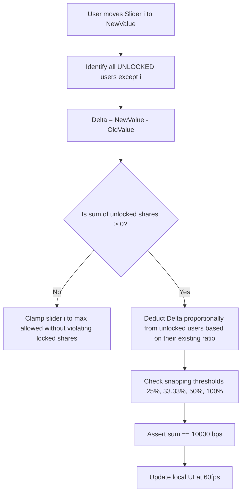

# TabTogether - Split Logic & Financial Math Specification (SPLIT_LOGIC.md)

> **Core Financial Rule**: Never use floating-point numbers (`0.1 + 0.2 === 0.30000000000000004`) for currency calculations. All internal computation uses **integer cents** and **integer basis points** ($1\% = 100\text{ bps}$, $100\% = 10,000\text{ bps}$).

---

## 1. Penny Rounding & The Largest Remainder Method

When dividing an amount that does not cleanly divide into cents (e.g. $\$100.00$ divided by $3$), we employ the **Largest Remainder Method (Hare-Niemeyer Algorithm)** to guarantee that:
$$\sum_{i=1}^{N} \text{allocated\_cents}_i = \text{total\_cents}$$

### The Algorithm:
1. Compute the raw unrounded float cent share for each participant:
   $$\text{raw\_share}_i = \frac{\text{total\_cents} \times \text{bps}_i}{10,000}$$
2. Take the integer floor as the baseline share:
   $$\text{base\_cents}_i = \lfloor \text{raw\_share}_i \rfloor$$
3. Calculate the fractional remainder for each person:
   $$\text{remainder}_i = \text{raw\_share}_i - \text{base\_cents}_i$$
4. Compute total leftover cents:
   $$\text{leftover} = \text{total\_cents} - \sum_{i=1}^{N} \text{base\_cents}_i$$
5. Sort participants descending by $\text{remainder}_i$. In case of an exact tie, break the tie deterministically by `user_id` (alphabetical order) or join order.
6. Allocate $+1$ cent to the top $\text{leftover}$ participants.

---

## 2. Worked Mathematical Examples

### Example 1: Clean Equal Split
- **Total Amount**: $\$210.00$ ($21,000$ cents)
- **Participants**: 4 people (Alex, Bob, Charlie, Dana)
- **Basis Points**: $2,500\text{ bps}$ each ($25.00\%$).
- **Calculation**:
  $$\text{share} = \frac{21,000 \times 2,500}{10,000} = \frac{52,500,000}{10,000} = 5,250\text{ cents} = \$52.50$$
- **Leftover**: $21,000 - (4 \times 5,250) = 0$ cents.
- **Result**: Exactly **$52.50 each**.

---

### Example 2: Uneven Division (The \$100.00 Split 3 Ways)
- **Total Amount**: $\$100.00$ ($10,000$ cents)
- **Participants**: 3 people (A, B, C)
- **Basis Points**:
  - Person A: $3,334\text{ bps}$ ($33.34\%$)
  - Person B: $3,333\text{ bps}$ ($33.33\%$)
  - Person C: $3,333\text{ bps}$ ($33.33\%$)
  - Total bps = $10,000$ ($100.00\%$)
- **Step 1 (Raw shares)**:
  - $\text{raw}_A = \frac{10,000 \times 3,334}{10,000} = 3,334.000\text{ cents}$
  - $\text{raw}_B = \frac{10,000 \times 3,333}{10,000} = 3,333.000\text{ cents}$
  - $\text{raw}_C = \frac{10,000 \times 3,333}{10,000} = 3,333.000\text{ cents}$
- **Step 2 (Base & Leftover)**:
  - Base: $A = 3334$, $B = 3333$, $C = 3333$.
  - Sum of base = $10,000$ cents.
  - Leftover = $0$ cents.
- **Result**:
  - Person A pays **$33.34**
  - Person B pays **$33.33**
  - Person C pays **$33.33**
  - Total: **$100.00**.

---

### Example 3: Unequal Food Claims + 10% Tax + 18% Tip
- **Food Items Ordered**:
  - Ribeye Steak: $\$60.00$ ($6,000$ cents) claimed $100\%$ by Alex.
  - Caesar Salad: $\$20.00$ ($2,000$ cents) claimed $100\%$ by Sam.
  - Nachos Platter: $\$40.00$ ($4,000$ cents) split $50/50$ ($2,000$ cents each) by Alex & Sam.
- **Subtotal**: $\$60 + \$20 + \$40 = \$120.00$ ($12,000$ cents).
- **Food Subtotals by Person**:
  - Alex Subtotal: $\$60 + \$20 = \$80.00$ ($8,000$ cents, or $\frac{80}{120} = 66.6667\%$).
  - Sam Subtotal: $\$20 + \$20 = \$40.00$ ($4,000$ cents, or $\frac{40}{120} = 33.3333\%$).
- **Tax (10%)**: $\$12.00$ ($1,200$ cents).
- **Tip (18%)**: $\$21.60$ ($2,160$ cents).
- **Total Overhead (Tax + Tip)**: $\$33.60$ ($3,360$ cents).

#### Proportional Overhead Allocation:
- **Alex's Share of Overhead**:
  $$\text{raw}_{\text{Alex}} = 3,360 \times \frac{8,000}{12,000} = 2,240\text{ cents} = \$22.40$$
- **Sam's Share of Overhead**:
  $$\text{raw}_{\text{Sam}} = 3,360 \times \frac{4,000}{12,000} = 1,120\text{ cents} = \$11.20$$
- **Total Settlement**:
  - **Alex Pays**: $\$80.00\text{ (food)} + \$22.40\text{ (tax/tip)} = \mathbf{\$102.40}$
  - **Sam Pays**: $\$40.00\text{ (food)} + \$11.20\text{ (tax/tip)} = \mathbf{\$51.20}$
  - **Grand Total Checked**: $\$102.40 + \$51.20 = \mathbf{\$153.60}$ ($\$120 \text{ bill} + \$12 \text{ tax} + \$21.60 \text{ tip}$). Exact to the penny!

---

## 3. Dynamic % Slider Redistribution Algorithm

When multiple users share an item, dragging a slider must always maintain $\sum \text{bps}_i = 10,000$.

### Proportional Delta Redistribution Formula:
Let user $k$ drag their slider to a new value $\text{new\_bps}_k$.
The difference is:
$$\Delta = \text{new\_bps}_k - \text{old\_bps}_k$$

Let $U$ be the set of other participants who are **not locked**:
$$S_U = \sum_{j \in U} \text{old\_bps}_j$$

If $S_U > 0$, for each user $j \in U$:
$$\text{new\_bps}_j = \max\left(0, \text{old\_bps}_j - \text{round}\left(\Delta \times \frac{\text{old\_bps}_j}{S_U}\right)\right)$$

Any remaining 1-basis-point drift due to integer rounding is applied to the largest unlocked share, ensuring $\sum_{all} \text{bps} \equiv 10,000$.

### Slider Magnetic Snapping:
To make splitting intuitive, the slider magnetically snaps when within $\pm 2.0\%$ of standard dining fractions:
- $20.00\%$ ($2,000\text{ bps}$)
- $25.00\%$ ($2,500\text{ bps}$)
- $33.33\%$ ($3,333\text{ bps}$)
- $50.00\%$ ($5,000\text{ bps}$)
- $66.67\%$ ($6,667\text{ bps}$)
- $100.00\%$ ($10,000\text{ bps}$)
A light haptic tick is fired on snap.
